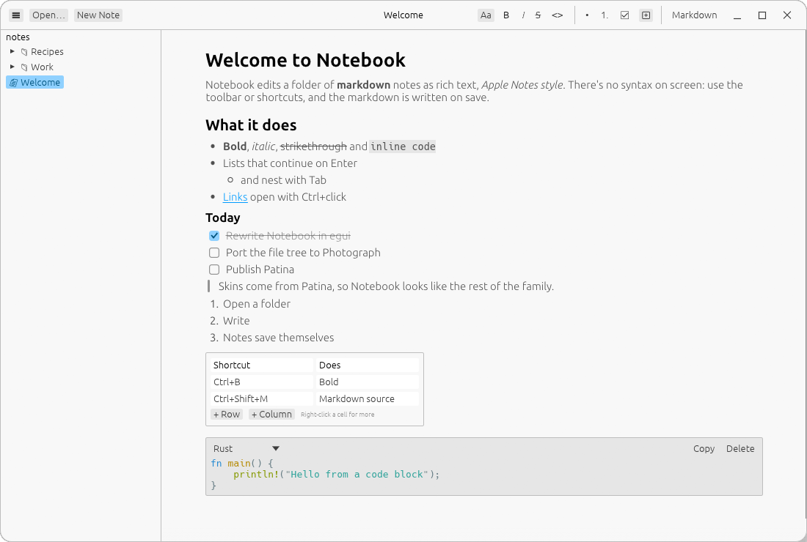
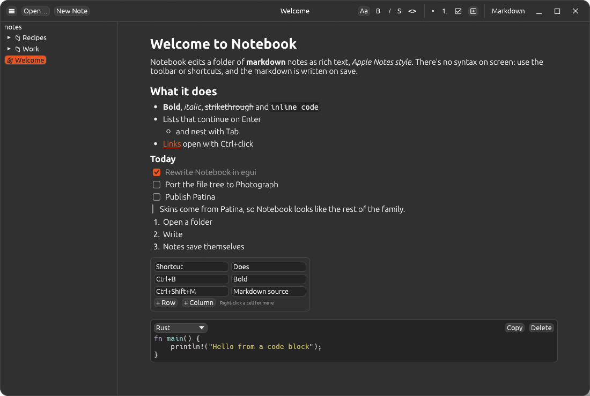

# Notebook

Notebook is a notes app for a folder of markdown files. It edits them as rich text, Apple Notes
style. There's no markdown on screen: you format with the toolbar or shortcuts, and the markdown is
written when the note saves.

It's built with [egui](https://github.com/emilk/egui) on [Patina](https://github.com/Sector-F-Labs/patina),
so it shares a window frame and skins with Photograph and UnAmp.



## Features

- **Rich text:** titles, headings, quotes, bulleted, numbered and nested lists, checklists, and
  bold, italic, strikethrough, inline code and links.
- **Tables** whose cells hold inline markdown.
- **Code blocks** with a language picker, syntax highlighting and a copy button.
- **Safe with any markdown:** anything Notebook can't show as rich text is kept exactly as written.
- **Markdown source** view (Ctrl+Shift+M) for when you want it.
- **Saving:** notes save themselves 1.5 s after you stop typing, through a temporary file, and a
  note you only open is never rewritten.
- **The sidebar:** a tree of notes and folders. Right-click for new note, new folder, rename and
  move to trash, and drag items to move them.
- **Skins** from Patina, including Dark Orange, and any skin in `~/.config/patina/skins/`.



## Shortcuts

| Keys | Does |
|---|---|
| Ctrl+O / Ctrl+N / Ctrl+Shift+N | Open folder / new note / new folder |
| Ctrl+S | Save now |
| Ctrl+B / Ctrl+I / Ctrl+E / Ctrl+Shift+X | Bold / italic / code / strikethrough |
| Ctrl+0 / 1 / 2 / 3 | Body / title / heading / subheading |
| Ctrl+Shift+8 / 7 / L | Bulleted / numbered list / checklist |
| Tab / Shift+Tab | Indent / outdent list items |
| Ctrl+Z / Ctrl+Shift+Z | Undo / redo |
| Ctrl+Shift+M | Markdown source |
| F2 | Rename the open note |

## Build

```sh
make            # list targets
make run        # run on the example notes
make test       # tests
make check      # tests and clippy
```

`cargo run -- <folder or note>` opens a folder as the workspace, or a single note.

Decisions are recorded in [docs/adr](docs/adr/README.md).

## License

BSD-3-Clause. The bundled Ubuntu fonts are under the Ubuntu Font Licence
([assets/fonts/UFL.txt](assets/fonts/UFL.txt)).
